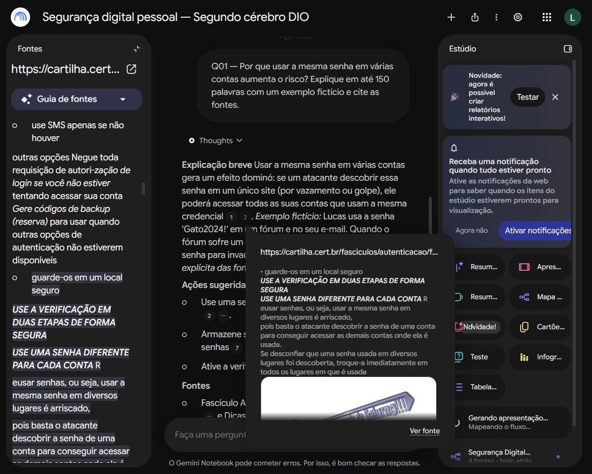

# Segundo cérebro: Segurança digital pessoal

Projeto do desafio DIO construído no **Gemini Notebook (NotebookLM)** com fontes oficiais, perguntas reais, conferência de citações e materiais do Estúdio.

**Objetivo:** aprender a proteger contas, dispositivos e arquivos pessoais, reconhecendo golpes e adotando hábitos de autenticação e backup com base em fontes confiáveis.

**Status:** notebook e materiais criados; repositório público e notebook com visualização por link liberada.

## Notebook

[Abrir Segurança digital pessoal — Segundo cérebro DIO](https://notebook.google.com/notebook/5fbb60b2-f3d9-4e30-882a-1506c0ec40e9).

Compartilhamento configurado como **Qualquer pessoa com o link pode ver este notebook**, com cópias desativadas. A configuração salva foi conferida na ferramenta. [Evidência do compartilhamento](evidencias/compartilhamento.jpg). O acesso em uma sessão independente ainda deve ser conferido pelo autor antes da submissão.

## Fontes que entraram

As quatro fontes foram importadas em 25/10/2026. A autoria foi verificada pelo [portal oficial da Cartilha](https://cartilha.cert.br/) e pela [lista de fascículos](https://cartilha.cert.br/fasciculos/). São materiais do CERT.br, mantido pelo NIC.br, com foco em conscientização de usuários.

| ID | Fonte | Formato | Por que foi escolhida |
| --- | --- | --- | --- |
| F01 | [Fascículo Autenticação](https://cartilha.cert.br/fasciculos/autenticacao/fasciculo-autenticacao.pdf) | PDF, edição novembro/2022 | Proteção e recuperação de contas; fonte principal dos testes Q01 e Q02 |
| F02 | [Fascículo Backup](https://cartilha.cert.br/fasciculos/backup/fasciculo-backup.pdf) | PDF, edição maio/2023 | Organização, proteção e verificação de cópias; fonte do teste Q05 |
| F03 | [Dicas Rápidas](https://cartilha.cert.br/dicas-rapidas/) | Página web | Hábitos de segurança e prevenção de golpes; conteúdo complementar |
| F04 | [Palestra CERT.br: Autenticação](https://www.youtube.com/watch?v=5QZRsH7vg5g) | Vídeo / transcrição | Vídeo indicado no portal oficial; explica conceitos e cuidados com autenticação |

A [curadoria](docs/fontes.md) registra os critérios, limites e a pesquisa complementar. Diversidade de formatos não significa diversidade institucional: os quatro itens pertencem ao mesmo ecossistema. As recomendações refletem essas fontes e suas edições; o projeto não constitui uma comparação de todos os padrões atuais.

## Diretriz aplicada

Configurada em **Configuração do notebook → Configurar as conversas → Personalizado**, com tamanho de resposta padrão. [Texto exato salvo](prompts/diretriz.md).

> Use exclusivamente as fontes selecionadas no notebook. Associe cada afirmação relevante a uma citação verificável. Nunca invente fontes, páginas, citações ou timestamps. Quando não houver suporte suficiente, diga isso claramente e explique qual informação falta.

## Perguntas, respostas e fontes

Foram executadas quatro perguntas do [roteiro](prompts/perguntas.md). A tabela apresenta sínteses das respostas reais; as cópias textuais e capturas estão em [evidências](evidencias/README.md). A validação é por amostragem das afirmações indicadas, não uma aprovação irrestrita de toda a saída da IA.

| Teste | Pergunta | Síntese da resposta real | Fonte e conferência |
| --- | --- | --- | --- |
| Q01 | Por que reutilizar a senha aumenta o risco? | Um vazamento pode comprometer outras contas que usam a mesma senha. | Citação 2 → F01, seção sobre senha diferente para cada conta. [Captura](evidencias/q01-citacao.jpg). |
| Q02 | O que muda com a verificação em duas etapas? | Acrescenta uma camada de verificação; ainda é preciso proteger códigos e recuperação de acesso. | Citação 1 → F01, seção sobre ativar a segunda etapa. [Captura](evidencias/q02-citacao.jpg). |
| Q05 | Como organizar e verificar backups? | Manter cópias em locais distintos e realizar verificações periódicas. | Citação 2 → F02, seção sobre mais de uma cópia; testes de cópias também constam em F03. [Captura](evidencias/q05-citacao.jpg). |
| Q08 | Quais botões usar num aplicativo fictício, versão 2099? | Reconheceu a ausência de informação, mas sugeriu nomes genéricos de menus com citações. | **Parcialmente aprovado:** F01/F03/F04 não comprovam uma interface fictícia. [Captura](evidencias/q08-limite.jpg). |

**Aprendizado do teste de controle:** um marcador de citação não garante que a fonte sustente a afirmação. A sugestão de menus do Q08 não deve ser tomada como orientação comprovada. [Registro detalhado da validação](docs/validacao.md).

## Materiais gerados no Estúdio

- [Apresentação original em PDF — 9 slides](materiais/slides-seguranca-digital.pdf).
- [Guia de estudo com quiz, gabarito e glossário](materiais/guia-estudo-notebook.md), copiado pelo comando da ferramenta.
- [Captura do mapa mental gerado](evidencias/mapa-mental.jpg). O mapa interativo permanece no notebook; a captura JPG não é apresentada como exportação nativa em PNG.
- [Revisão e procedência dos materiais](materiais/README.md).

Os materiais gerados são objetos de estudo e revisão. O PDF original foi preservado, inclusive com imperfeições de texto e recomendações cuja sustentação deve ser conferida nas fontes; os pontos encontrados estão registrados na revisão.

## Deep Research e critério de seleção

A pesquisa complementar encontrou **41 fontes**. Foi examinada a lista, mas nenhuma sugestão adicional nem o relatório da IA foi importado automaticamente. Materiais institucionais fora do recorte de proteção pessoal foram deixados de fora. [Registro da decisão](docs/deep-research.md) · [Captura](evidencias/deep-research.jpg).

## Como reproduzir

1. Seguir o [roteiro de execução](docs/execucao.md).
2. Importar as fontes e aplicar a diretriz.
3. Fazer perguntas e abrir as citações.
4. Registrar concordâncias, erros e ausência de suporte.
5. Gerar materiais no Estúdio e revisar o resultado.

## Conferência para entrega

- [x] Tema e objetivo definidos.
- [x] Fontes em PDF, texto e vídeo importadas.
- [x] Diretriz personalizada configurada.
- [x] Perguntas reais e citações verificadas por amostragem.
- [x] Evidências e materiais com conteúdo incluídos.
- [x] Repositório público na conta lucasestork.
- [x] Liberar visualização do notebook por link e conferir a configuração salva.
- [ ] Autor testar a abertura em outra conta ou sessão antes da submissão.
- [ ] Autor revisar os materiais e submeter o endereço deste repositório à DIO.

## Autoria e transparência

Projeto de lucasestork, executado com apoio de IA na pesquisa, organização, operação do notebook e documentação. Não foi realizado um teste de aprendizagem com respostas do aluno; o quiz está disponível para prática. Os PDFs-fonte e o vídeo não foram redistribuídos neste repositório. Seus direitos e licenças permanecem com os titulares.
